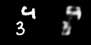
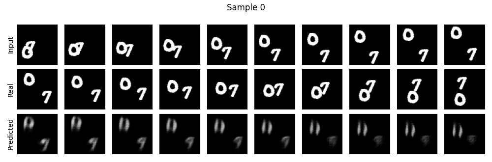

# WorldVideo

Prédiction de frames vidéo avec un **ConvLSTM** en PyTorch : à partir des 10 premières images d'une séquence, le modèle prédit les 10 suivantes.

Projet Hub réalisé à Epitech (juin–juillet 2026).

## Résultats

À gauche la séquence réelle, à droite la prédiction du modèle.

<p align="center">
  
  
  
</p>

Détail d'une séquence : les 10 frames d'entrée, les 10 frames réelles qui suivent, puis les 10 frames prédites.

<p align="center">
  
</p>

## Fonctionnement

- **Données** : [Moving MNIST](http://www.cs.toronto.edu/~nitish/unsupervised_video/), soit 10 000 séquences de 20 images 64×64 (80 % entraînement, 20 % validation).
- **Modèle** : ConvLSTM à 4 couches de 128 canaux, avec LayerNorm (`src/model.py`).
- **Entraînement** : perte MSE, Adam (lr 1e-3), ReduceLROnPlateau, 20 époques, suivi avec Weights & Biases (`src/train.py`).
- **Évaluation** : MSE et SSIM sur le jeu de validation (`src/evaluate.py`).

## Lancer le projet

```bash
pip install -r requirements.txt
python data/download.py        # télécharge Moving MNIST (~800 Mo)
python -m src.train            # entraînement (GPU recommandé)
python -m src.evaluate         # MSE / SSIM du meilleur modèle
python -m src.visualize        # génère les comparaisons et GIFs dans results/
```

## Structure

```
data/download.py     téléchargement du dataset
src/dataset.py       Dataset PyTorch (entrée 10 frames → cible 10 frames)
src/model.py         architecture ConvLSTM
src/train.py         boucle d'entraînement
src/evaluate.py      métriques
src/visualize.py     grilles de comparaison et GIFs
results/             meilleur modèle et visualisations
```

## Crédits

- Architecture ConvLSTM adaptée d'[OpenSTL](https://github.com/chengtan9907/OpenSTL) (licence Apache 2.0). `results/openstl_convlstm_reference.gif` est leur visualisation de référence.
- Shi et al., *Convolutional LSTM Network: A Machine Learning Approach for Precipitation Nowcasting*, NeurIPS 2015.
- Srivastava et al., *Unsupervised Learning of Video Representations using LSTMs*, 2015 (Moving MNIST).
